<p align="center"></p>

# TaskPulse

Ein Task-Manager für Windows 10/11, geschrieben in Rust. Er zeigt GPU-Werte pro Prozess und hat eine dauerhafte Anzeige direkt in der Taskleiste.

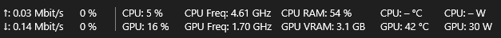

### ⬇ [TaskPulse-Setup.exe herunterladen](https://github.com/ALEXEXE420/TaskPulse/releases/latest/download/TaskPulse-Setup.exe)

Windows auf ARM (z. B. NVIDIA RTX Spark N1X, Snapdragon X): [TaskPulse-Setup-ARM64.exe](https://github.com/ALEXEXE420/TaskPulse/releases/latest/download/TaskPulse-Setup-ARM64.exe) (ab Version 0.1.8)

Linux (x86_64, die meisten Distributionen): [TaskPulse-x86_64.AppImage](https://github.com/ALEXEXE420/TaskPulse/releases/latest/download/TaskPulse-x86_64.AppImage) (ab Version 0.1.8) – herunterladen, ausführbar machen (`chmod +x TaskPulse-x86_64.AppImage`) und starten.

Windows 10 (2004 oder neuer) und Windows 11. Was sich in welcher Version geändert hat, steht im [Änderungsprotokoll](CHANGELOG.md) und bei jedem [Release](https://github.com/ALEXEXE420/TaskPulse/releases).

## Funktionen

- **Prozesse:** CPU, Arbeitsspeicher, Datenträger, **GPU-Auslastung, GPU-Engine, VRAM und VRAM-Anteil je Prozess**, gruppiert wie im Windows-Task-Manager, mit Farbskala. „Task beenden“ per Knopf oder Entf.
- **Leistung:** Verlaufsgrafiken für CPU, Arbeitsspeicher, jeden Datenträger einzeln, Netzwerk und GPU (alle Engines, Kartenhersteller, Treiber).
  - **CPU-Aufbau:** logische Prozessoren nach **CCD** (AMD Ryzen, Threadripper, EPYC) bzw. **P-, E- und LP-E-Kernen** (Intel), je Kern Takt, Auslastung, Watt, Spannung und Temperatur.
  - **Arbeitsspeicher:** jeder Riegel einzeln mit Temperatur, dazu die laufenden RAM-Timings.
  - **Grafikkarte:** Hot-Spot- und Speichertemperatur (NVIDIA RTX 30–50), PCIe-Verbindung.
  - **Spezifikation:** ausklappbar für CPU und GPU (ähnlich wie CPU-Z und GPU-Z), mit theoretischer GPU- und KI-Rechenleistung.
  - **Datenträger:** Namen wie im Explorer, mit Modell und Temperatur.
- **Benchmark:** Aufzeichnung im Sekundentakt mit Graphen für **FPS, Frametimes, 1 % und 0,1 % Low, Ruckler**, Temperaturen, Takt, Auslastung und Watt. FPS über die Windows-Grafik-Ereignisse (wie PresentMon) – ohne sich ins Spiel einzuklinken. Export als Log (für KI/Excel) und CSV.
- **Taskleisten-Anzeige**, die auch ohne Hauptfenster läuft:
  - Upload und Download, auf Wunsch mit Auslastung der Leitung in %
  - CPU-Auslastung, -Temperatur, -Takt und -Watt
  - CPU RAM
  - GPU-Auslastung, -Temperatur, -Takt und -Watt
  - GPU VRAM
  - Die Felder sind frei anzuordnen, die Anzeige lässt sich links oder rechts platzieren und verschieben, auch auf dem zweiten Monitor.
- **Hersteller:**
  - Grafikkarten von NVIDIA laufen über NVML (mit Watt), AMD und Intel über die Windows-Schnittstellen.
  - Für CPU-Temperatur und -Watt bei AMD (Ryzen) und Intel wird der Treiber [PawnIO](https://pawnio.eu/) gebraucht.
- **Autostart-Verwaltung:** Programme, die beim Anmelden starten, getrennt nach ein- und ausgeschaltet; per Schalter umstellen oder neue Apps hinzufügen.
- **Weitere Funktionen:** „immer mit Adminrechten“ ohne UAC-Abfrage, Installer, automatische Updates mit Änderungsprotokoll, Fehlerberichte und Diagnosebericht.

## Bilder

### Prozesse
GPU-Auslastung, GPU-Engine und VRAM je Prozess, gruppiert wie im Windows-Task-Manager, mit Farbskala.

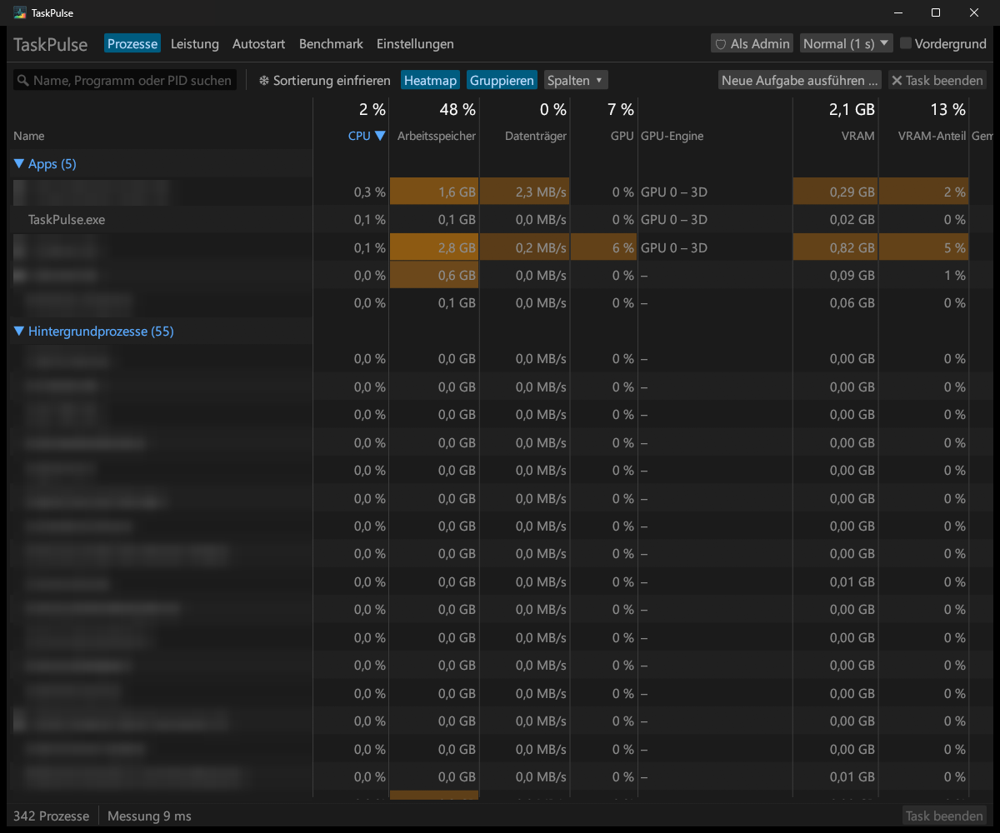

### Leistung – CPU
Jeder Kern mit Takt, Auslastung, Watt und Spannung, nach CCD gruppiert (bei Intel nach P-, E- und LP-E-Kernen). Darunter lässt sich die **Spezifikation** ausklappen, ähnlich wie bei CPU-Z: Cache, Befehlssätze, Mainboard und BIOS.

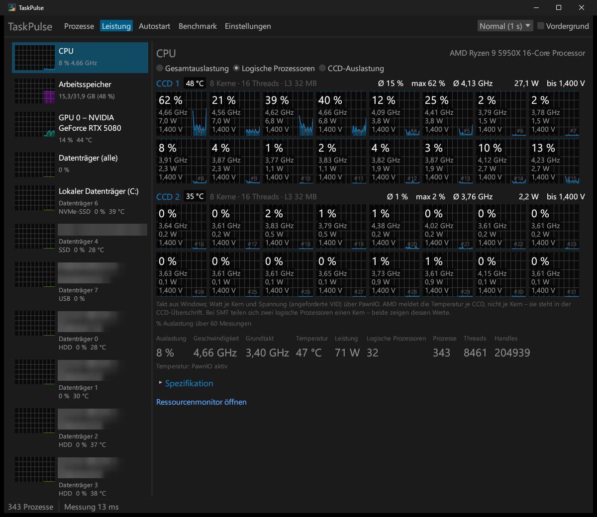

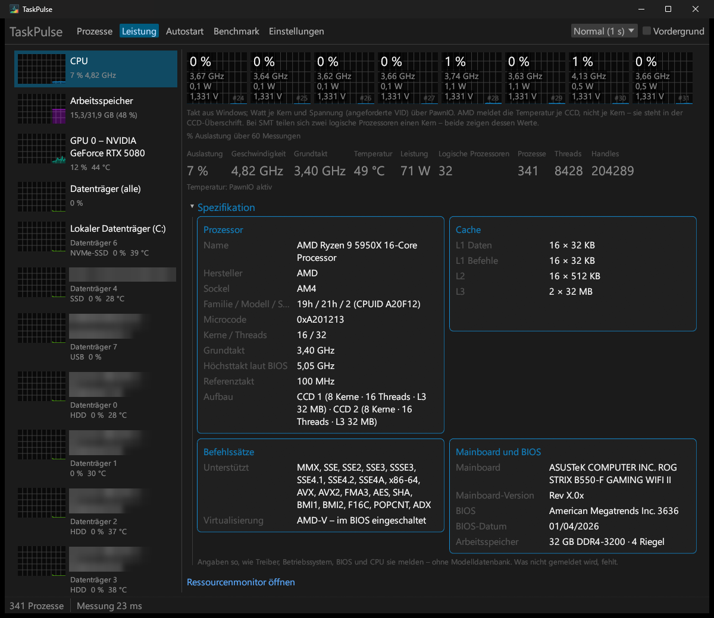

### Leistung – Arbeitsspeicher
Jeder RAM-Riegel einzeln mit Hersteller, Modell und Temperatur, dazu die laufenden **Timings** direkt aus dem Speichercontroller.

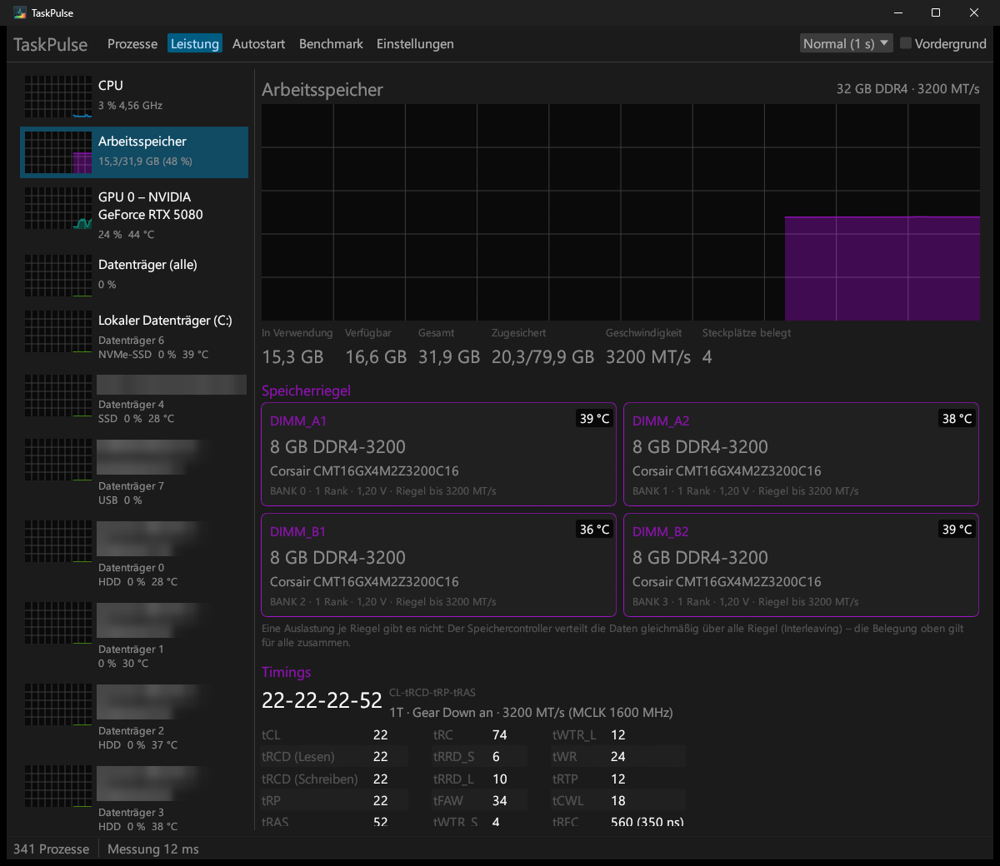

### Leistung – Grafikkarte
Alle GPU-Engines, Hot-Spot- und Speichertemperatur (NVIDIA RTX 30–50) und PCIe-Verbindung. Die Spezifikation zeigt, ähnlich wie GPU-Z, unter anderem Architektur, Speicherbandbreite, Resizable BAR sowie die theoretische GPU- und KI-Rechenleistung.

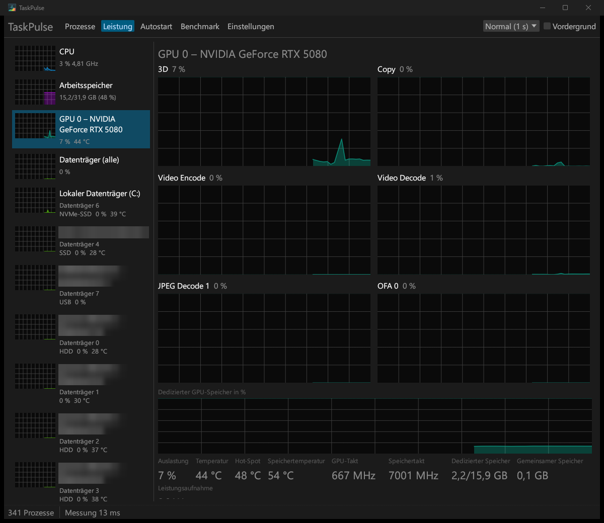

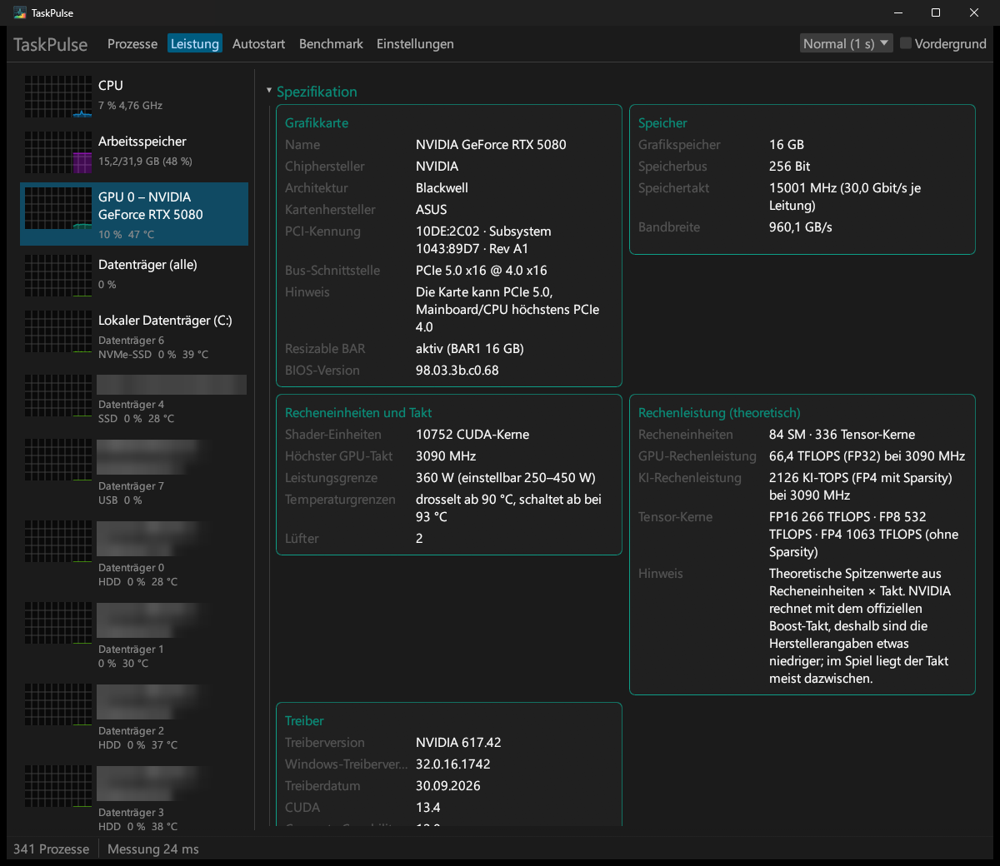

### Leistung – Datenträger
Namen wie im Explorer, nach Laufwerksbuchstaben sortiert, mit Modell, Typ und Temperatur. Laufwerke im Verbund und leere USB-Adapter werden als solche gekennzeichnet.

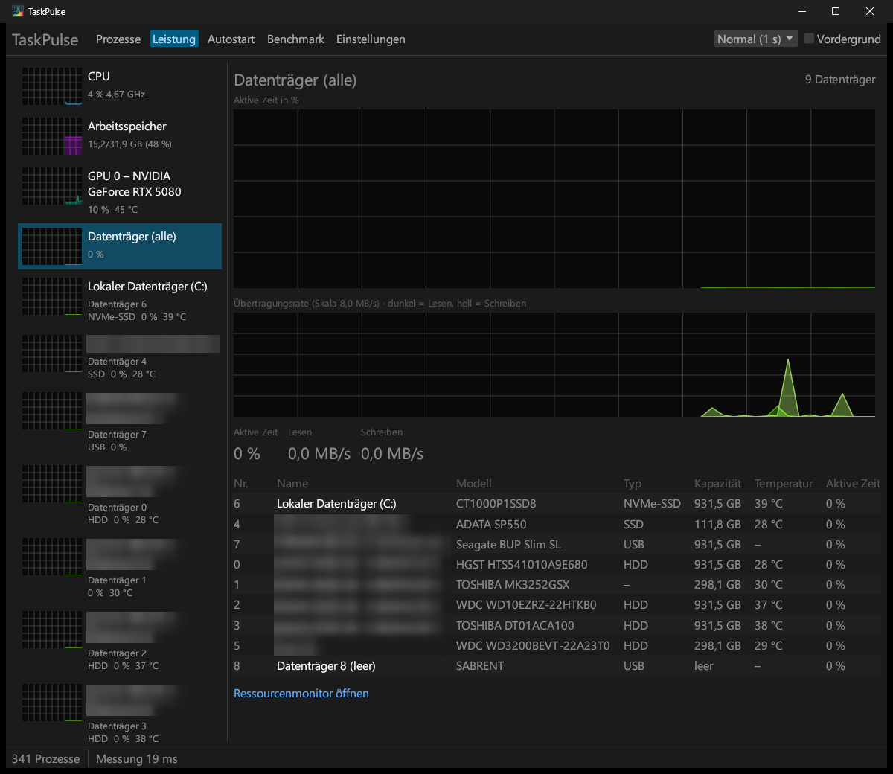

### Autostart
Übersichtlich getrennt nach eingeschalteten und ausgeschalteten Programmen. Jedes lässt sich per Schalter umstellen, neue Apps kannst du hinzufügen.

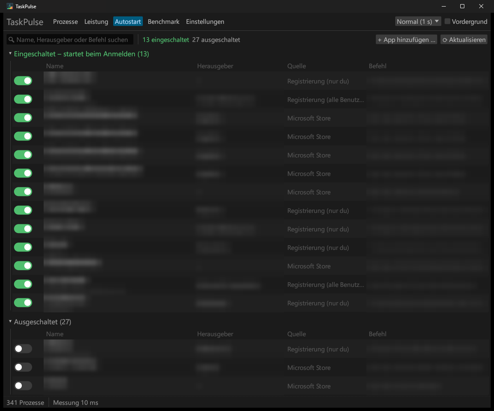

### Benchmark
FPS, Frametimes, 1 % und 0,1 % Low und Ruckler, Export als Log und CSV (Bild mit Beispielwerten).

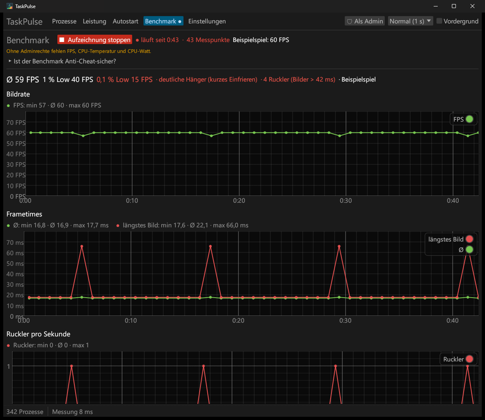

### Einstellungen
Die Felder der Taskleisten-Anzeige lassen sich frei auswählen und anordnen, mit Vorschau der aktuellen Werte.

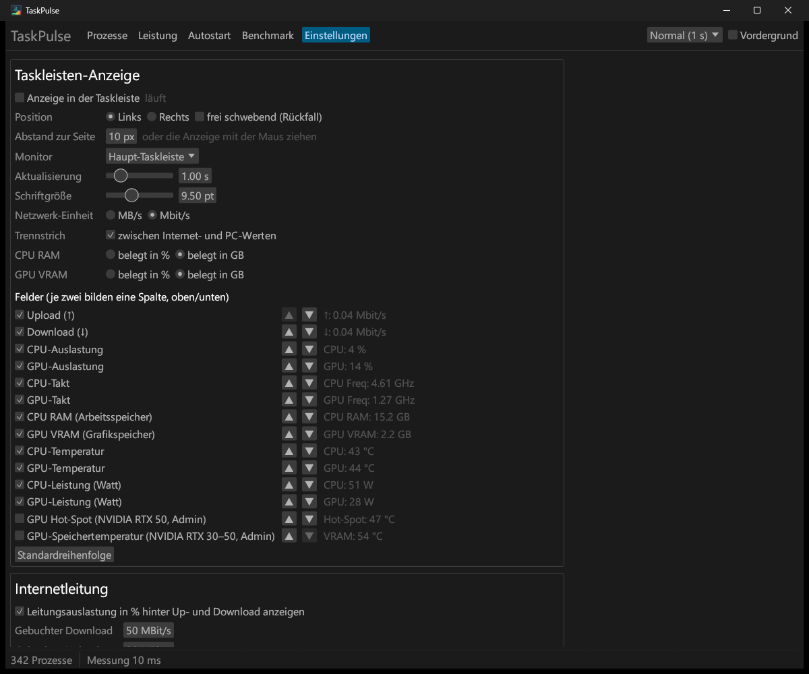

## Installation

1. **[TaskPulse-Setup.exe herunterladen](https://github.com/ALEXEXE420/TaskPulse/releases/latest/download/TaskPulse-Setup.exe)** und starten.
2. Optionen wählen, dann **Installieren** klicken. TaskPulse wird nach `C:\Program Files\TaskPulse` installiert.
3. Optional [PawnIO](https://pawnio.eu/) installieren. Erst dann zeigt TaskPulse CPU-Temperatur und CPU-Watt an.

Die Datei ist nicht digital signiert, deshalb warnt Windows SmartScreen beim ersten Start. Klicke dort auf „Weitere Informationen“ und dann auf „Trotzdem ausführen“.

Deinstallieren geht über *Einstellungen → Apps → TaskPulse*.

## Updates

TaskPulse sucht beim Start und danach alle 12 Stunden auf GitHub nach einem neuen Release.

- **Wenn ein neues Release da ist:**
  - Ist das Hauptfenster zu, installiert die Taskleisten-Anzeige das Update selbst und startet TaskPulse neu.
  - Ist das Hauptfenster offen, erscheint oben ein Hinweis mit **Jetzt installieren**.
- **Einstellungen:** Unter *Einstellungen → Updates* kannst du die automatische Suche abschalten oder von Hand nach Updates suchen.
- **Adminrechte:** Läuft TaskPulse ohne Adminrechte, fragt Windows beim Update einmal nach, weil `Program Files` geschützt ist.
- **Daten:** Das ist der einzige Internetzugriff von TaskPulse. Es wird keine Telemetrie gesendet.

## Selbst bauen

Du brauchst [Rust](https://rustup.rs/) (stable).

```powershell
cargo build --release
# Ergebnis: target\release\TaskPulse.exe
```

Mit der MSVC-Toolchain (Visual Studio Build Tools) reicht dieser Befehl. Für die GNU-Toolchain gibt es `build.ps1`, das die MinGW-binutils in den Pfad einträgt.

Hat die Datei „Setup“ im Namen, also zum Beispiel `TaskPulse-Setup.exe`, startet dieselbe EXE als Installer.

## Neue Version veröffentlichen

```powershell
powershell -ExecutionPolicy Bypass -File veroeffentlichen.ps1 0.1.7
```

Vorher in `CHANGELOG.md` unter „Unveröffentlicht“ eintragen, was sich geändert hat – ohne Eintrag bricht das Skript ab. Das Skript macht daraus den Abschnitt der neuen Version (mit Datum), setzt die Version in `Cargo.toml`, macht einen Commit und lädt den Tag `v0.1.7` hoch. Danach baut GitHub Actions (`.github/workflows/release.yml`) die Datei `TaskPulse-Setup.exe` und veröffentlicht sie als Release; die Änderungen aus `CHANGELOG.md` stehen dort als Beschreibung. Bereits installierte Versionen finden das Update dann von selbst.

Von Hand geht es so: In `Cargo.toml` die `version` erhöhen, committen und einen Tag `v<Version>` pushen. Tag und Version müssen übereinstimmen, sonst bricht der Bau ab.

## Projektaufbau

| Ordner | Inhalt |
|---|---|
| `src/sensors` | Messwerte: CPU (PDH, PawnIO), GPU (NVML, D3DKMT, Leistungsindikatoren), Prozesse, Netzwerk, Datenträger |
| `src/taskbar` | Taskleisten-Anzeige (Win32, Direct2D/DirectWrite) |
| `src/ui` | Hauptfenster (egui) |
| `src/installer.rs`, `src/updater.rs` | Installer und Updates über GitHub-Releases |
| `resources/icon` | Programmsymbol |
| `resources/pawnio` | PawnIO-Module für AMD und Intel (LGPL, siehe `COPYING`) |

## Lizenz

Für TaskPulse selbst ist noch keine Lizenz festgelegt. Die Dateien in `resources/pawnio` stammen aus [PawnIO.Modules](https://github.com/namazso/PawnIO.Modules) und stehen unter der LGPL 2.1 (`resources/pawnio/COPYING`).
